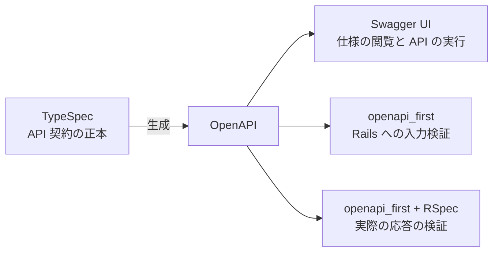

TypeSpec と openapi_first を組み合わせると、Rails の API が仕様に適合しているかを機械的に検証できます。
型や必須項目の検証条件をテストへ書き写す手間が減り、仕様変更後も同じテストで実装を確かめられます。
AI エージェントにも実装を任せやすくなります。
このスキーマ駆動の開発体験がとても良かったので紹介します。

ここでいう API 契約は、リクエストとレスポンスの型や必須項目、HTTP ステータスなど、仕様に記述した条件です。
その仕様を先に決め、ドキュメントと実装の検証に使う進め方を、この記事ではスキーマ駆動開発と呼びます。

この記事に合わせて、タスク管理 API のサンプルアプリを作りました。
https://github.com/AudioStakes/rails-typespec-openapi-first-sample

Swagger UI から動作を試し、仕様変更 → テスト失敗 → 実装修正 → テスト成功を体験できます。
以降はこのサンプルで説明します。
セットアップと演習の手順は [README](https://github.com/AudioStakes/rails-typespec-openapi-first-sample#readme) を参照してください。

**動作確認に使用したバージョン**

| 技術 | バージョン |
| --- | --- |
| TypeSpec（`@typespec/compiler`） | 1.17.0 |
| openapi_first | 4.2.0 |

## TypeSpec なら、TypeScript に似た構文で API の型と操作を記述できる

[TypeSpec](https://typespec.io/docs/language-basics/overview/) は、TypeScript に似た構文で API の型や操作を記述する言語です。
サンプルの `api/main.tsp` にあるタスクの型を見てみます。

```typespec
@minLength(1)
@maxLength(100)
scalar TaskTitle extends string;

enum TaskStatus {
  todo,
  doing,
  done,
}

model Task {
  id: int64;
  title: TaskTitle;
  status: TaskStatus;
}

model CreateTask {
  title: TaskTitle;
}
```

`TaskTitle` は1〜100文字の文字列、`TaskStatus` は三つの値のいずれかです。
プロパティは `?` を付けなければ必須になります。
入力とレスポンスで `TaskTitle` を使い回せるので、文字数の条件を一度書けば済みます。

HTTP の操作も同じファイルに書きます。
次は、一覧取得の定義を抜粋したものです。

```typespec
@route("/api/tasks")
interface Tasks {
  @get
  list(@query status?: TaskStatus): Task[] | BadRequest;
}
```

`GET /api/tasks` はタスクの配列を返し、任意の `status` クエリで絞り込めます。
`BadRequest` は、同じファイルに定義している400のエラーレスポンスです。
ほかの操作も `@post`、`@patch`、`@route` などで定義しています。

## TypeSpec を正本にして、OpenAPI を自動生成できる

TypeSpec で書いた仕様は、[OpenAPI emitter](https://typespec.io/docs/emitters/openapi3/reference/emitter/) で OpenAPI に変換できます。
OpenAPI は HTTP API の仕様を記述するための標準で、仕様の表示や検証に使えるツールがあります。
標準 CLI `tsp compile` で、`api/main.tsp` から OpenAPI を生成します。

```sh
npx --no-install tsp compile api/main.tsp --emit @typespec/openapi3
```

`npx --no-install` でインストール済みの CLI を呼び出し、`--emit` で OpenAPI emitter を指定しています。
出力先などは `tspconfig.yaml` から読み込み、このサンプルでは `openapi/openapi.yaml` を生成します。

生成した同じ OpenAPI を、Swagger UI、Rails の入力検証、RSpec の契約テストで共有します。
Swagger UI の表示には YAML の配信と assets の配置も必要で、準備と起動の手順は README にまとめています。



TypeSpec を API 契約の唯一の正本（Single Source of Truth）とし、生成した YAML は手で編集しません。
CI では再生成した結果との比較と契約テストを実行し、再生成忘れや YAML だけの変更も検出します。

:::details 生成物の同期を標準 CLI で確認する

OpenAPI を一時ディレクトリへ生成し、保存済みの YAML と比較してから RSpec を実行します。

```sh
generated_dir=$(mktemp -d) &&
  npx --no-install tsp compile api/main.tsp \
    --emit @typespec/openapi3 --output-dir "$generated_dir" &&
  diff -u openapi/openapi.yaml "$generated_dir/openapi.yaml" &&
  bundle exec rspec
```

生成物に差があれば `diff` が失敗し、RSpec へ進みません。

:::

## openapi_first は OpenAPI に基づいて、実際のリクエストとレスポンスを検証できる

[openapi_first](https://github.com/ahx/openapi_first/blob/v4.2.0/README.md) は、OpenAPI に基づく検証を提供する Ruby gem です。
生成した OpenAPI を Rails の初期化時に一度登録し、実行時の入力検証と RSpec の契約テストで共有します。

```ruby
# config/initializers/openapi_first.rb から抜粋
OpenapiFirst.register(Rails.root.join("openapi/openapi.yaml"))
```

入力は `OpenapiFirst::Middlewares::RequestValidation` で検証します。

- 型、文字数、enum などの制約に合わない入力を、コントローラーの処理前に拒否します。
- `POST /api/tasks` に `{}` を送ると、必須の `title` がないため400を返し、タスクを保存しません。
- サンプルでは `/api` 以下に適用し、Swagger UI の HTML や assets は対象から外しています。

サンプルは `request.env[OpenapiFirst::REQUEST]` の検証結果から入力を取得します。
値の扱いの詳細は README を参照してください。
Rails の `params` が自動的に置き換わるわけではありません。

レスポンスの検証には、[公式が推奨している Contract Testing](https://github.com/ahx/openapi_first/blob/v4.2.0/README.md#response-validation) を使います。
RSpec の request spec が送受信した内容を観測します。
Rails 環境を読み込んだ後の、主要な設定の抜粋です。

```ruby
# spec/support/openapi_contract.rb から抜粋
OpenapiFirst::Test.setup do |test|
  test.ignored_unknown_status = []
end

OpenapiFirst::Test.observe(Rails.application)
```

`Test.setup` は設定、`Test.observe` は実際の HTTP の観測を担当します。
通常の API 実行では入力を検証し、RSpec 実行時には入力とレスポンスを検証する構成です。

このサンプルではエラー応答も検証するため、`ignored_unknown_status = []` としています。

既存の request spec から、タスク作成のテストを抜粋します。

```ruby
it "saves a task with the default status and returns it" do
  expect { post "/api/tasks", params: { title: "Review the API" }, as: :json }
    .to change(Task, :count).by(1)

  task = Task.last
  expect(task.attributes).to include("title" => "Review the API", "status" => "todo")
  expect(response).to have_http_status(:created)
  expect(response.parsed_body).to include("id" => task.id, "title" => task.title, "status" => "todo")
end
```

型や必須項目の照合は openapi_first に任せ、初期状態が `todo` であることや DB に保存されることは通常の expectation でも確認します。
契約への適合と、業務上の正しさを両方確かめる役割分担です。

:::details エラー応答の検証には設定と補足処理を加えている

`ignored_unknown_status` の既定値は `[401, 404, 500]` です。
利用版の契約テストでは、定義済みのステータスでも、この一覧に含まれる応答の不適合は例外になりません。
不正入力を意図して送るテストの設定や、通常の観測では検証が省かれる415応答の補足検証を含む全体は、[契約テストの設定ファイル](https://github.com/AudioStakes/rails-typespec-openapi-first-sample/blob/7e536a1990c132a0e5b200ffaf793ea296643867/spec/support/openapi_contract.rb)を参照してください。

:::

## 仕様に変更を加えたあとも、同じテストで API 契約への適合を確認できる

実際に試す場合は、次の「演習の準備」を済ませた作業コピーで進めてください。

:::details 演習の準備

[README](https://github.com/AudioStakes/rails-typespec-openapi-first-sample#readme)の動作環境に合わせて、リポジトリのルートで依存関係と DB を準備します。

```sh
bundle install
npm ci
bundle exec rails db:prepare
```

元のアプリと DB を保つため、README の「実装や仕様を変更するための作業コピー」を作り、以降の変更とコマンドはその中で行います。

:::

まず、変更前の OpenAPI を生成し、RSpec が成功することを確認します。

```sh
npx --no-install tsp compile api/main.tsp --emit @typespec/openapi3
bundle exec rspec
```

結果は `36 examples, 0 failures` です。

タスクが完了しているかを表す `completed` を、レスポンスに追加することにします。
`api/main.tsp` の `Task` だけを変更します。

```diff
 model Task {
   id: int64;
   title: TaskTitle;
   status: TaskStatus;
+  completed: boolean;
 }
```

`completed` は必須の boolean です。
入力用のモデルは変えないので、呼び出す側がこの値を送る必要はありません。
OpenAPI を再生成して、先ほどと同じ request spec を実行します。

```sh
npx --no-install tsp compile api/main.tsp --emit @typespec/openapi3
bundle exec rspec
```

Rails はまだ `completed` を返していないため、テストは失敗します。
実行結果の抜粋です。

```text
OpenapiFirst::ResponseInvalidError:
  Response body is invalid: object at root is missing required properties: completed

36 examples, 12 failures
```

テストファイルを変えず、`completed` の expectation も追加していません。
新しい OpenAPI を読み込んだ openapi_first が、必須項目の欠落を検出しました。
TypeSpec の変更が、そのまま検証条件になっています。

次に、`app/controllers/api/tasks_controller.rb` の JSON を作る処理を変更します。
`status` が `done` のときだけ `true` を返すようにします。

```diff
-      task.attributes.slice("id", "title", "status")
+      task.attributes.slice("id", "title", "status").merge("completed" => task.status == "done")
```

同じ RSpec を実行すると、`36 examples, 0 failures` に戻ります。

```sh
bundle exec rspec
```

仕様の条件をテストへ書き写さずに、同じテストで失敗 → 成功を確認できました。
仕様変更の確認が楽になったと感じたのは、この部分です。

追加した契約が検証するのは、`completed` の存在と boolean 型です。
すべてのタスクで `false` を返しても、この条件は満たします。
`done` のときだけ `true` になるという業務上の意味まで保証するには、別途テストを追加する必要があります。
また、既存の応答が変更後の契約にも適合していれば、仕様変更による失敗は起きません。

## API 仕様への適合を機械的に検証できるので、AI エージェントに実装を任せやすくなる

AI エージェントが実装とテストを同じ誤解から作ると、両者が一致していても API 仕様とはずれている可能性があります。
TypeSpec を共通の判定基準にすると、確認を次のように分担できます。

- 合意した仕様から検証条件を読み込み、テストで実行した API の契約違反を検出する。
- 生成物の同期確認と契約テストを CI でも実行し、同じ判定基準を共有する。
- レビューでは TypeSpec の差分、仕様の妥当性、業務の振る舞いを確認する。

検証対象は、テストで実行した経路と条件に限られます。
認証認可や業務上の正しさ、入力値や分岐の網羅は、別途テストで確認します。

## おわりに

TypeSpec で決めた契約をテストへ写し直さず、実際の API と照合できることが、この組み合わせの良さです。
[サンプル](https://github.com/AudioStakes/rails-typespec-openapi-first-sample)で `completed` を追加し、仕様変更 → テスト失敗 → 実装修正 → テスト成功をぜひ試してみてください。

## 参考文献

- [TypeSpec 公式ドキュメント：言語の概要](https://typespec.io/docs/language-basics/overview/)
- [TypeSpec 1.17.0 の公式リポジトリ](https://github.com/microsoft/typespec/tree/typespec-stable%401.17.0)
- [TypeSpec 公式ドキュメント：OpenAPI emitter](https://typespec.io/docs/emitters/openapi3/reference/emitter/)
- [TypeSpec 公式ドキュメント：CLI の使い方](https://typespec.io/docs/handbook/cli/)
- [OpenAPI Specification 3.1.0](https://spec.openapis.org/oas/v3.1.0.html)
- [openapi_first v4.2.0 README](https://github.com/ahx/openapi_first/blob/v4.2.0/README.md)
- [openapi_first v4.2.0 の公式 Rails サンプル](https://github.com/ahx/openapi_first/tree/v4.2.0/examples/rails_app)
- [openapi_first v4.2.0 の契約テストの実装](https://github.com/ahx/openapi_first/blob/v4.2.0/lib/openapi_first/test.rb)と[設定および既定値](https://github.com/ahx/openapi_first/blob/v4.2.0/lib/openapi_first/test/configuration.rb)
- [Rails Guides：Rails on Rack](https://guides.rubyonrails.org/v8.1/rails_on_rack.html)
